  

  

  

- 🕹️ **Web Developer** who enjoys building useful things that solve real problems
- 🎓 Graduated as **Web Development Technician** from **COVAO**
- 🔐 **Certified in Cybersecurity** and IT fundamentals (Cisco)
- 🖥️ Experience with **server administration** and **system security**
- 🏗️ Building private projects with **Laravel**, **PHP** and modern frameworks
- ⛏️ Side quest: running my own modded game server
- 💡 Always eager to **learn and level up**

  
  
  
  
  

| Quest | Status | Loot |
|---|---|---|
| 🗂️ **Vacation & leave control system** — replaced paper forms with uploads and Excel reports | ✅ Cleared | Web app + server admin |
| 🌅 **Solsticio** — version 2 of the leave system, rebuilt from scratch | ⚔️ v2 | Private repo |
| 🌮 **Q'Tortilla** — website for a local tortilla business | ✅ Cleared | [qtortilla.com](https://qtortilla.com) |
| 💳 **Loan request site** — database + Telegram bot that forwards form responses | ✅ Cleared | Archived |
| ⛏️ **Modded game server** — setup, mods and maintenance | 🟢 Online | Side quest |

  
  

  

  

📊 <b>More stats</b>

 

  
  
  

  

Pixel art drawn from scratch for this profile · font: Press Start 2P (SIL OFL) · regenerate with <code>python scripts/build_assets.py</code>
